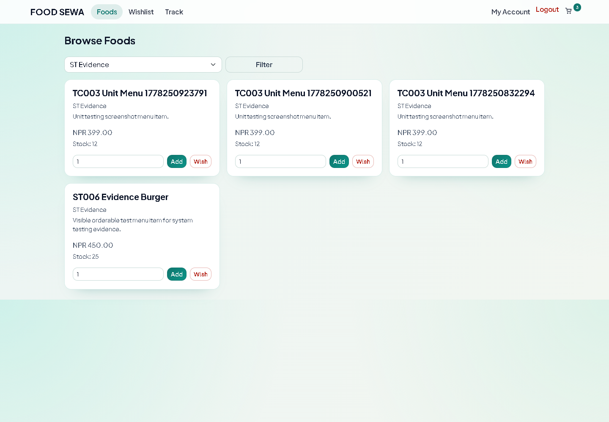

# FOOD-SEWA

A PHP and MySQL food delivery application with a customer storefront and an administrator dashboard.

This screenshot comes from the local application's existing system-test captures and shows test menu items. There is currently no public hosted demo.

## Features

- Customer registration, login, profiles, delivery addresses, and support tickets.
- Food categories, menu browsing, stock availability, carts, and wishlists.
- Checkout, coupons, order status, and delivery tracking.
- Payment integrations for eSewa, Khalti, and Stripe, including a Stripe webhook handler.
- Administrator pages for foods, categories, customers, orders, delivery, payments, coupons, and settings.
- Database schema, migration, project report, and database diagrams.

## Run locally

Requirements: PHP 8.1 or later with `mysqli` and `curl`, MySQL 8, and a PHP-capable server such as Laragon. External payment providers require your own sandbox credentials and configuration.

1. Clone this repository into your web root, for example `C:\laragon\www\FOODSEWA`.
2. Copy `.env.example` to `.env` and set your database credentials. Existing local `.env` files should be retained rather than overwritten.
3. Create an empty `foodsewa` database with `utf8mb4_unicode_ci` collation and import `deliver.sql` using phpMyAdmin or the MySQL client. The public export contains the schema and food/category sample data; it does not contain customer accounts, administrators, addresses, orders, payments, or private settings.
4. Run `migrations/2026-04-17-ensure-auto-increment-ids.sql` against that database.
5. Start your web server and MySQL, then visit `http://localhost/FOODSEWA/`. `APP_BASE_URL=auto` detects the server URL; set it explicitly if your server layout requires it.
6. Register a customer through **Login/Register**. Administrator accounts must be provisioned separately; no default administrator password is published.

To provision an administrator, generate a password hash using PHP's `password_hash()` with `PASSWORD_DEFAULT`, then insert your own name, email, and generated hash into the `admins` table. Do not commit the password, hash, or resulting database dump.

Use payment sandbox accounts for local testing. Payment flows also depend on the provider's allowed callback URLs and webhook settings; source availability does not imply a configured production payment service.

## Project layout

| Path | Purpose |
| --- | --- |
| `index.php` | Customer storefront |
| `user/` | Customer pages |
| `admin/` | Administrator pages |
| `components/` | Database, sessions, guards, application helpers, payment integrations |
| `assets/` | Stylesheets and database diagrams |
| `uploads/foods/` | Food images used by the catalog |
| `deliver.sql` | Public database schema and catalog sample data |
| `migrations/` | Database updates |
| `scripts/` | Screenshot and report utilities |
| `docs/screenshots/` | Selected application preview |

The existing screenshot utilities require Playwright and locally provisioned test accounts/data. Their original test fixtures refer to a `foodmandu` URL; adjust the URL and fixtures for your environment before running them. Python report utilities have their own dependencies.

## Repository sync

This repository contains the source synchronized from the local FOODSEWA project. Local environment files, full database backups (`*.local.sql`), runtime caches, installed dependencies, and generated test output are excluded from Git.

The source was imported onto this repository's original README history. The earlier local Git history is preserved in a local backup branch and is not part of the public history, because its database dump contained account and transaction records.
